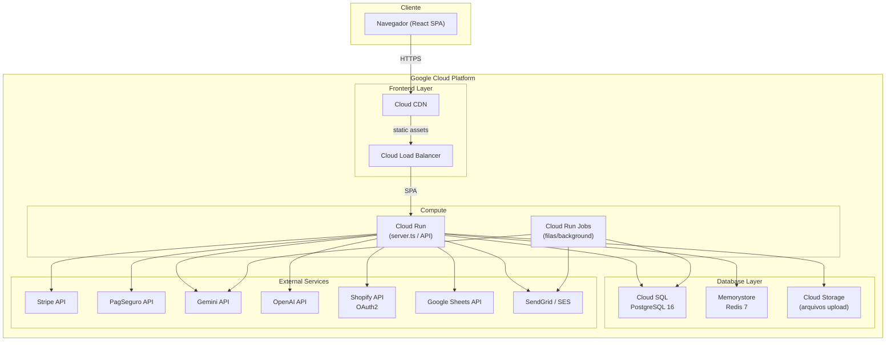
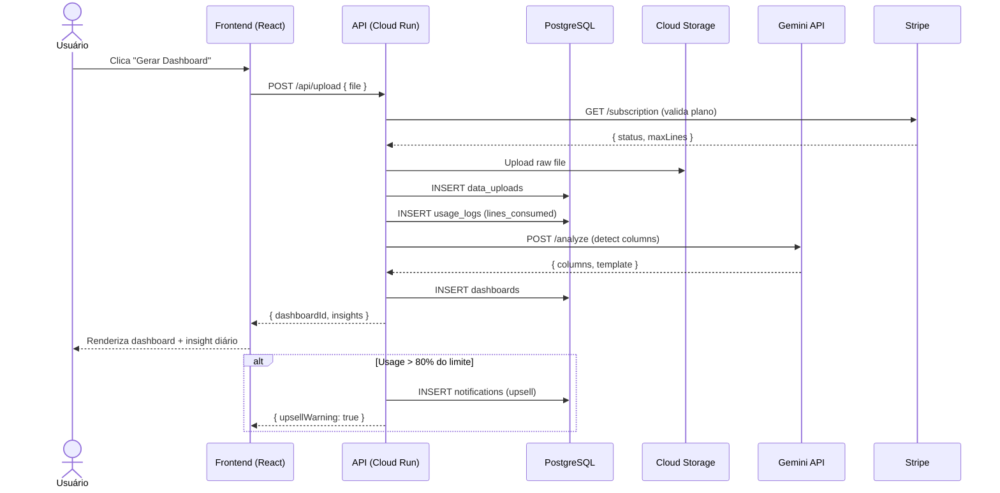
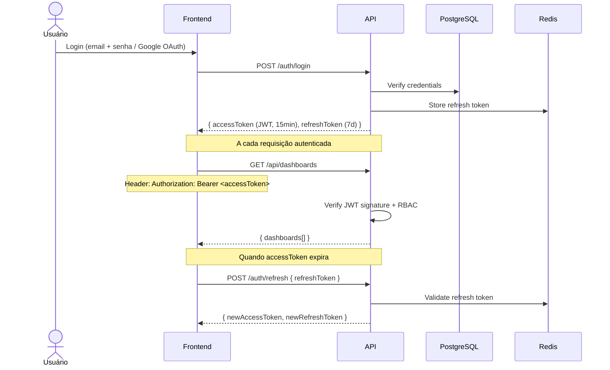

# Arquitetura do VarejoBI — SaaS Zero-Touch

## Stack

```
Frontend    React 19 + Vite 6 + Tailwind 4 + Motion
Backend     Node.js + Express (server.ts) → Futuro: Fastify/NestJS
Database    PostgreSQL 16 + Redis 7
Cache       Redis (sessões JWT, rate-limit, filas)
Storage     Google Cloud Storage (arquivos upload)
Auth        JWT + OAuth 2.0 (Google, Shopify)
Payments    Stripe (primário) + PagSeguro (fallback BR)
AI          Gemini API + OpenAI API (fallback)
Deploy      Google Cloud Run + Cloud SQL + Memorystore
Domain      Registro.br → Cloud DNS
```

## Diagrama da Arquitetura



## Fluxo de Dados — Upload de Planilha



## Fluxo de Autenticação



## Estrutura de Diretórios (Backend Futuro)

```
src/
├── server.ts                  # Entry point (Express)
├── config/
│   ├── database.ts            # Prisma client
│   ├── redis.ts               # ioredis client
│   ├── stripe.ts              # Stripe instance
│   └── env.ts                 # Zod validation para .env
├── modules/
│   ├── auth/
│   │   ├── auth.controller.ts
│   │   ├── auth.service.ts
│   │   ├── auth.routes.ts
│   │   ├── jwt.strategy.ts
│   │   ├── oauth.strategy.ts
│   │   └── guards/
│   │       ├── jwt.guard.ts
│   │       └── rbac.guard.ts
│   ├── users/
│   │   └── users.service.ts
│   ├── plans/
│   │   ├── plans.controller.ts
│   │   ├── plans.service.ts
│   │   └── plans.routes.ts
│   ├── subscriptions/
│   │   ├── subscriptions.controller.ts
│   │   ├── subscriptions.service.ts
│   │   ├── subscriptions.routes.ts
│   │   └── webhooks/
│   │       ├── stripe.webhook.ts
│   │       └── pagseguro.webhook.ts
│   ├── dashboards/
│   │   ├── dashboards.controller.ts
│   │   ├── dashboards.service.ts
│   │   └── dashboards.routes.ts
│   ├── uploads/
│   │   ├── uploads.controller.ts
│   │   ├── uploads.service.ts
│   │   └── uploads.routes.ts
│   ├── chatbots/
│   │   ├── chatbots.controller.ts
│   │   ├── chatbots.service.ts
│   │   └── chatbots.routes.ts
│   ├── affiliates/
│   │   ├── affiliates.controller.ts
│   │   ├── affiliates.service.ts
│   │   └── affiliates.routes.ts
│   ├── ai/
│   │   ├── ai.service.ts
│   │   ├── gemini.provider.ts
│   │   ├── openai.provider.ts
│   │   └── column.detector.ts
│   ├── billing/
│   │   ├── billing.service.ts
│   │   └── usage.middleware.ts
│   ├── notifications/
│   │   ├── email.service.ts
│   │   ├── email.sequences.ts
│   │   └── templates/
│   └── churn/
│       ├── churn.detector.ts
│       └── churn.webhook.ts
├── common/
│   ├── guards/
│   ├── decorators/
│   ├── filters/
│   └── pipes/
└── data/
    └── documentation.ts        # RAG documents
```

## RBAC — Níveis de Acesso por Plano

| Feature                    | FREE | Starter | Pro  | Business | Enterprise |
|---------------------------|------|---------|------|----------|------------|
| Upload CSV/Excel          | 1    | 2K/mo   | 20K  | 100K     | ∞          |
| Dashboards                | 1    | 1       | 3    | 10       | ∞          |
| Marketplace integrations  | 0    | 1       | 3    | ∞        | ∞          |
| AI Insights               | ×    | ×       | ✓    | ✓        | ✓          |
| Churn Prediction          | ×    | ×       | ✓    | ✓        | ✓          |
| API REST                  | ×    | ×       | ×    | ✓        | ✓          |
| WhatsApp Alerts           | ×    | ×       | ✓    | ✓        | ✓          |
| Affiliates Panel          | ×    | ×       | ×    | ✓        | ✓          |
| Priority Support          | ×    | ×       | ✓    | ✓        | ✓          |
| SLA 99.9%                 | ×    | ×       | ×    | ×        | ✓          |

## Estratégia de Deploy (Zero-Touch)

1. **Push no GitHub** → Cloud Build detecta e triggera
2. Cloud Build roda `npm run build` + docker build
3. Push da imagem para Artifact Registry
4. Cloud Run faz rolling update (zero-downtime)
5. Migrations rodam automáticas via `prisma migrate deploy`
6. CDN invalidada para assets estáticos

## Observabilidade

- **Logs**: Cloud Logging (estruturado JSON)
- **Métricas**: Cloud Monitoring (latência p95, erros 5xx, uso CPU/mem)
- **Alertas**: 
  - P50 > 500ms no /api/upload
  - Taxa de erro > 1%
  - Faturamento recorrente cai > 10% no mês
  - Churn rate mensal > 8%
